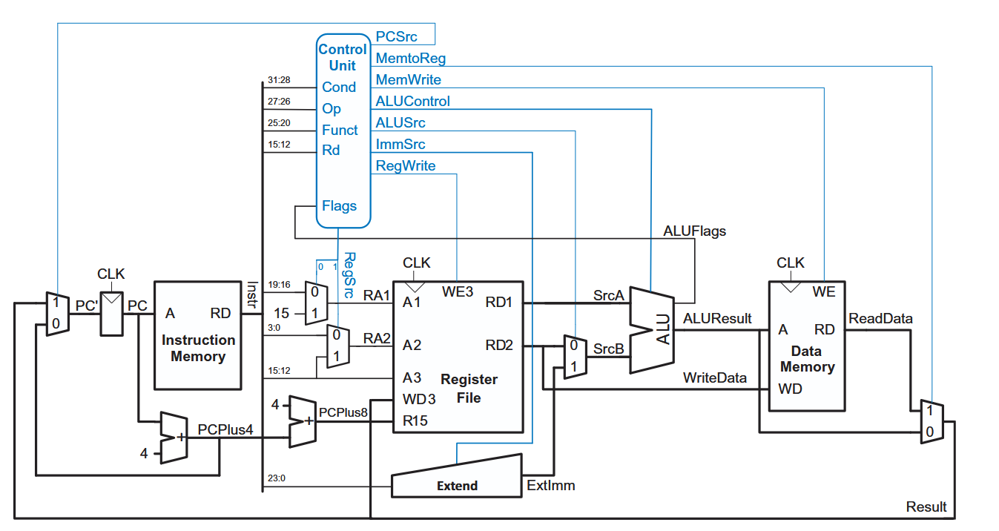
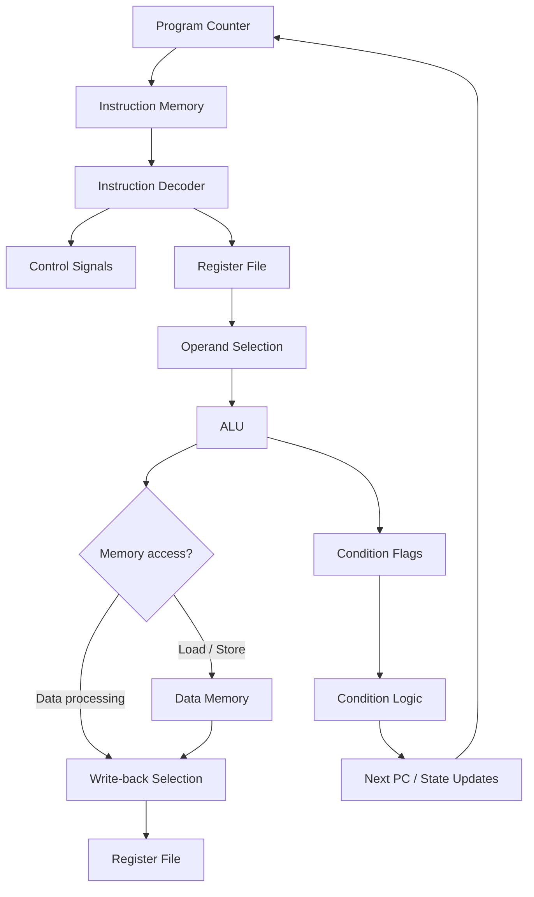

<div align="center">

# ARMv4-Based Single-Cycle Microprocessor

### From instruction fetch to execution — a 32-bit processor built in SystemVerilog.

[](#)
[](#)
[](#)
[](#)

**An independent hardware design project**

<br>



</div>

---

## Project Overview

What happens inside a processor when an instruction is executed?

This project explores that question through the design and implementation of a **32-bit, ARMv4-based single-cycle microprocessor** using SystemVerilog.

The processor brings together an instruction fetch path, register file, ALU, instruction decoder, conditional execution logic, and instruction/data memories. Its datapath is designed so that an instruction progresses through its required operations within a single clock cycle.

The goal was to move beyond studying processor architecture in theory and build a working RTL model that could be simulated, inspected, and debugged at signal level.

> **Implementation scope:** This is an educational implementation of a selected ARM instruction subset. It is ARMv4-based, but it is not a complete ARMv4-compatible processor.

## Inside the Processor

The design is organized into a **datapath** and a **controller**. The controller decodes the current instruction and generates the signals that steer the datapath.

### 1. Datapath

| Component | Responsibility |
|---|---|
| Program Counter | Holds the current instruction address and selects the next PC value |
| Instruction Memory | Supplies the instruction addressed by the PC |
| Register File | Provides two combinational read ports and one clocked write port |
| ALU | Performs arithmetic and logical operations and produces condition flags |
| Immediate Extension | Extends data-processing, memory-transfer, and branch immediates |
| Data Memory | Supports word-oriented load and store operations |
| Multiplexers & Adders | Select operands, write-back data, and sequential/branch addresses |

The register file contains 15 general-purpose registers. Reads of register number `R15` return `PC + 8`, following the ARM-style behavior modeled in this project.

### 2. Control Unit

The control path consists of:

- **Main decoder:** Identifies the instruction class and generates high-level control signals.
- **ALU decoder:** Selects the ALU operation from the instruction function bits.
- **Condition logic:** Evaluates the instruction condition against the stored flags and qualifies register writes, memory writes, and PC updates.
- **Flag registers:** Store the Negative, Zero, Carry, and Overflow flags when the instruction requests an update.

## Instruction Set Implemented

The decoder supports the following selected instruction operations:

| Instruction | Operation | Purpose |
|:---:|---|---|
| `ADD` | Addition | Adds register/immediate operands |
| `SUB` | Subtraction | Subtracts operands |
| `AND` | Bitwise AND | Performs a logical AND |
| `ORR` | Bitwise OR | Performs a logical OR |
| `LDR` | Load register | Reads a word from data memory |
| `STR` | Store register | Writes a word to data memory |
| `B` | Branch | Updates the program counter using a branch offset |

### Conditional Execution & Flags

The ALU generates four condition flags:

| Flag | Meaning |
|:---:|---|
| `N` | Negative — most-significant bit of the result |
| `Z` | Zero — result equals zero |
| `C` | Carry — carry-out for supported arithmetic operations |
| `V` | Overflow — signed arithmetic overflow |

The condition-checking logic evaluates ARM condition fields using these flags before allowing the relevant state updates.

## How an Instruction Travels

At a high level, the processor follows this execution path:



*The diagram is a conceptual view of the instruction flow; the actual datapath and control connections are shown in the architecture image above.*

## Simulation & Verification

A processor-level testbench is included to exercise the integrated design.

### Test program

The supplied machine-code program (`program/memfile.dat`) contains a short sequence of data-processing and memory-transfer instructions. The testbench monitors memory writes and checks for the expected result:

| Check | Expected value |
|---|---:|
| Data-memory address | `0x64` (decimal `100`) |
| Data written | `7` |

When the expected address/data pair is observed during a memory-write cycle, the testbench prints:

```text
Simulation Succeeded
```

The testbench also emits a VCD waveform file so internal and top-level signals can be inspected.

### Waveform inspection

The RTL is split into focused modules rather than one large source file. This makes it easier to trace the datapath, inspect control signals, and reuse individual building blocks. The module-level source organization is described below.

The repository includes:

- `simulation/processor.vcd` — recorded simulation waveform
- `simulation/arm_signals.gtkw` — GTKWave signal-view configuration

Open the included waveform with:

```bash
gtkwave simulation/processor.vcd simulation/arm_signals.gtkw
```

The VCD is a saved simulation artifact. To reproduce the test, run the testbench in your own simulator using the source and memory files in this repository. The memory initialization path is `program/memfile.dat`; run the simulation from the repository root so this relative path resolves.

## Run the Simulation

### Xilinx Vivado

1. Create or open a Vivado project.
2. Add all `.sv` files under `rtl/` as design sources, preserving the folder structure (or add the files recursively).
3. Add `testbench/ARM_testbench.sv` as a simulation source.
4. Set `testbench` as the simulation top.
5. Make sure `program/memfile.dat` is available from the simulation working directory (or update the `$readmemh` path to match your simulator's working directory).
6. Run **Behavioral Simulation** and inspect the transcript and waveform.

### GTKWave

To inspect the included waveform, open the repository root in a terminal and run the GTKWave command shown above.

## Repository Structure

```text
ARMv4-Single-Cycle-Processor-Modular/
├── rtl/
│   ├── control/                  # Decoder, controller, condition logic
│   ├── datapath/                 # ALU, register file, muxes, adders, registers
│   └── top/                      # ARM core and memory/top-level integration
├── testbench/
│   └── ARM_testbench.sv          # Processor-level testbench
├── program/
│   └── memfile.dat               # Machine-code test program
├── docs/
│   └── architecture.png          # Processor architecture diagram
├── simulation/
│   ├── processor.vcd             # Simulation waveform
│   └── arm_signals.gtkw          # GTKWave configuration
├── README.md
└── SOURCE_NOTES.md
```

### RTL module map

| File | Responsibility |
|---|---|
| `rtl/top/memory_and_top.sv` | Top-level integration, instruction ROM, data RAM |
| `rtl/top/arm.sv` | Connects controller and datapath |
| `rtl/control/controller.sv` | Combines instruction decoder and conditional logic |
| `rtl/control/decoder.sv` | Main instruction decoder and ALU decoder |
| `rtl/control/conditional_logic.sv` | Qualifies register, memory, PC, and flag updates |
| `rtl/control/check_flags.sv` | Evaluates ARM condition codes |
| `rtl/datapath/datapath.sv` | Connects PC, register file, ALU, and write-back path |
| `rtl/datapath/alu.sv` | Arithmetic/logic operations and N/Z/C/V flags |
| `rtl/datapath/register_file.sv` | Register storage and read ports |
| `rtl/datapath/extend.sv` | Immediate-value extension |
| `rtl/datapath/mux.sv` | Parameterized multiplexers |
| `rtl/datapath/adder.sv` | Parameterized adder |
| `rtl/datapath/flopr.sv` | Resettable register and enabled flag register |

## Tools & Technologies

<p>
  
  
  
</p>

- **SystemVerilog** — hardware description and RTL implementation
- **Xilinx Vivado** — HDL project development and simulation
- **GTKWave** — waveform inspection and debugging

## What This Project Demonstrates

- Translating a processor architecture into synthesizable RTL-style modules
- Connecting a datapath with an instruction decoder and control logic
- Designing ALU operations and arithmetic condition flags
- Implementing register-file and memory interfaces
- Modeling instruction sequencing, branching, and conditional execution
- Using testbenches and waveforms to inspect hardware behavior

## Possible Extensions

Some directions for taking the design further:

- Expand the implemented instruction subset.
- Add broader instruction-level and edge-case test coverage.
- Add automated self-checking tests for ALU operations, flags, loads, stores, and branches.
- Run synthesis and inspect resource utilization and timing.
- Add a documented Vivado project setup for easier reproduction.

---

## 👩‍💻 Author

**Haris Saleem**

Electrical Engineering Student  
Personal Project

---

⭐ If you found this project useful, consider giving it a star!

<div align="center">

**Built with SystemVerilog · Simulated with Vivado · Inspected with GTKWave**

*Computer Architecture | RTL Design | Digital Systems*

</div>
